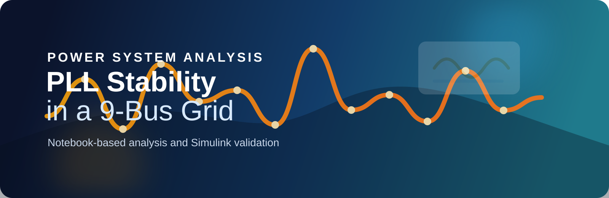
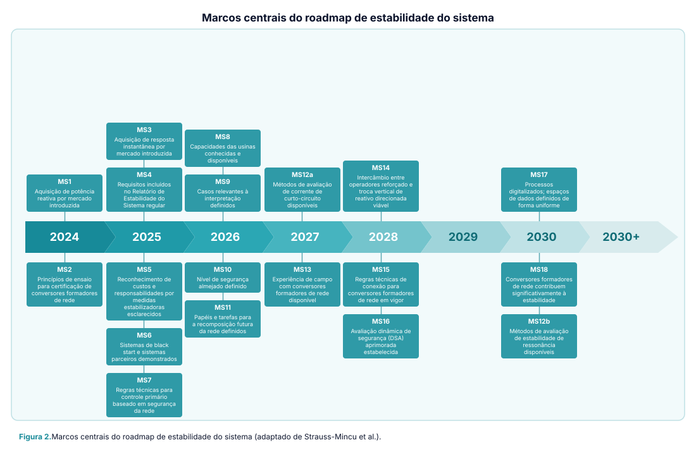
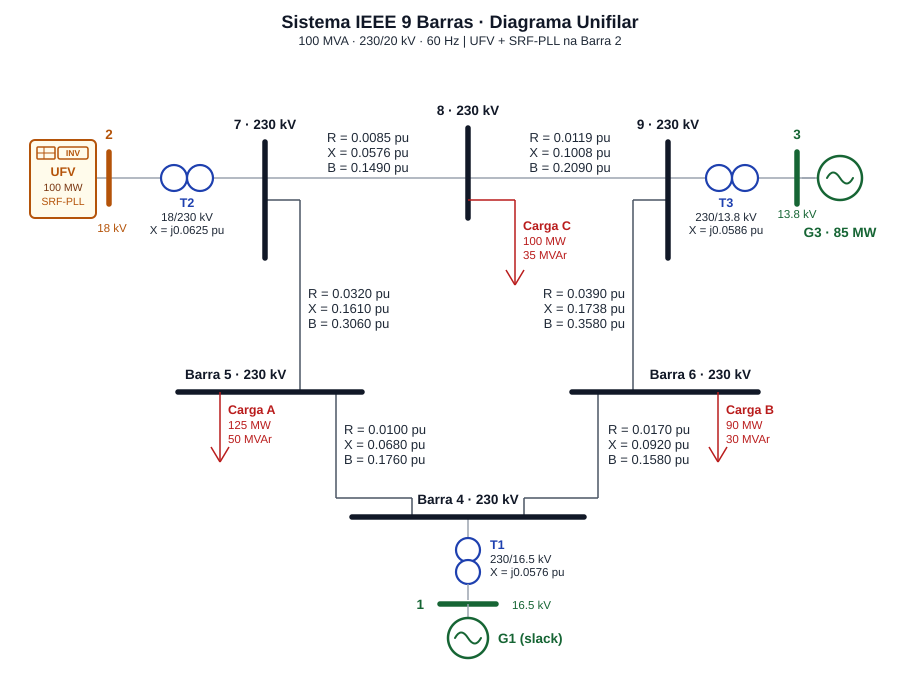
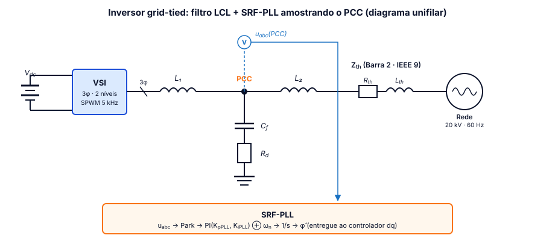
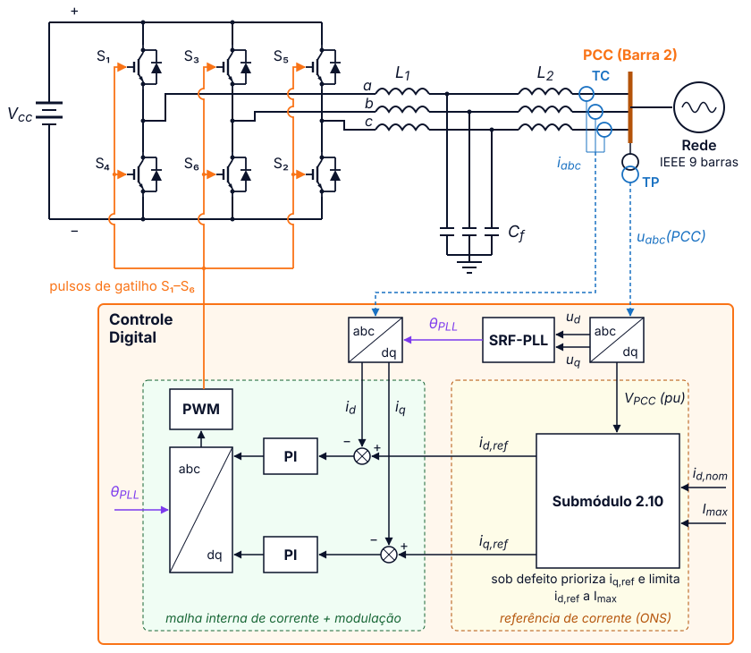
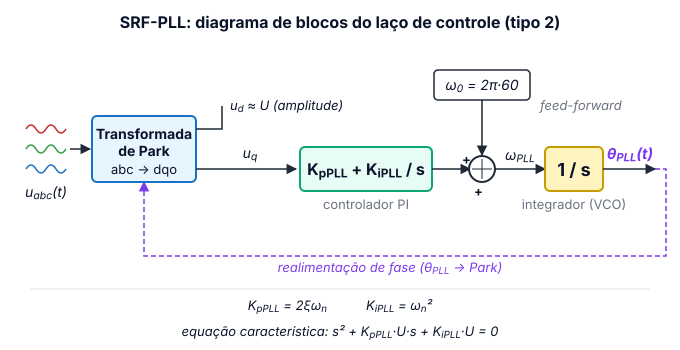
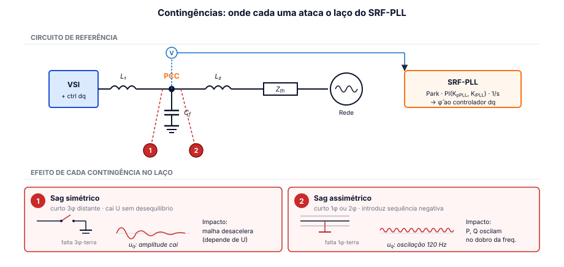
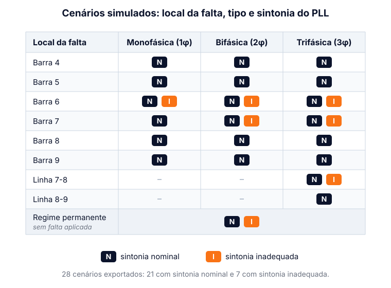
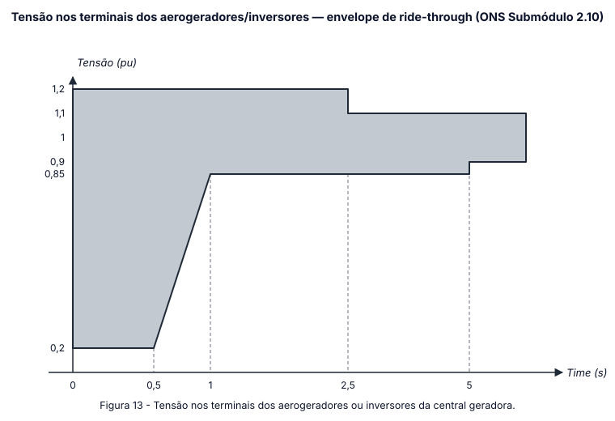
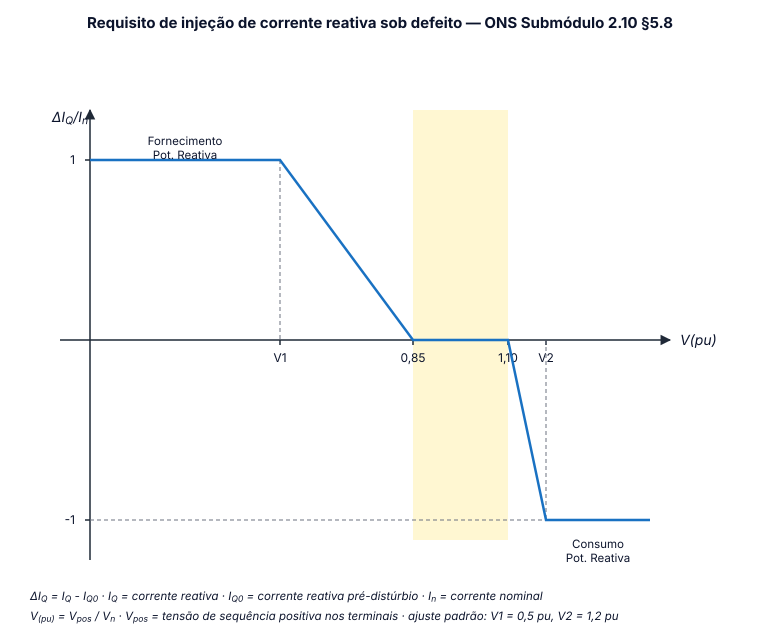

# Comportamento do SRF-PLL de Inversores Frente a Contingências em Sistemas Elétricos

<p align="center">
  
</p>

<p align="center">
  
  
  
  
  
  
</p>

**TCC — Engenharia Elétrica (Sistemas de Potência)**
UERJ — Faculdade de Engenharia | 2026
Autores: Bruno Henrique de Oliveira & Victor Hugo de Avelar Rezende
Orientador: Prof. Dr. Oscar Cuaresma Zevallos | Coorientador: Prof. Dr. André Guilherme Peixoto Alves

---

## Sumário

- [Motivação](#motivação)
- [Objetivo](#objetivo)
- [Sistema modelado](#sistema-modelado)
- [Arquitetura do SRF-PLL](#arquitetura-do-srf-pll)
- [Sintonia do PLL](#sintonia-do-pll)
- [Cenários simulados](#cenários-simulados)
- [Requisitos normativos](#requisitos-normativos-ons--ieee-1547)
- [Principais resultados](#principais-resultados)
- [Como reproduzir](#como-reproduzir)
- [Dashboard interativo](#dashboard-interativo)
- [Conteúdo do repositório](#conteúdo-do-repositório)
- [Referências](#referências)

---

## Motivação

A perturbação de **15 de agosto de 2023** no Sistema Interligado Nacional (SIN)
desligou **23.368 MW**, cerca de 34,5% da carga do SIN. O Relatório de Análise
de Perturbação (RAP) do ONS concluiu que o desempenho dos controles de usinas
eólicas e fotovoltaicas ficou **aquém do previsto nos modelos matemáticos**.

O caso brasileiro não é isolado: Chile (fev/2025) e Península Ibérica (abr/2025)
tiveram eventos ligados a redes com alta penetração de recursos baseados em
inversor (IBR). Em todos eles, a sincronização dos conversores com a rede
aparece no centro do problema, e o algoritmo mais usado para isso é o
**SRF-PLL** (Synchronous Reference Frame Phase-Locked Loop).

<p align="center">
  
</p>

---

## Objetivo

Analisar o desempenho dinâmico do SRF-PLL de um inversor fotovoltaico
conectado à rede frente a faltas simétricas e assimétricas, avaliando o
rastreamento de fase, a injeção de potência e o suporte de reativo exigido
pelo ONS, com a sintonia nominal do PLL e com uma sintonia inadequada.

---

## Sistema modelado

- **Rede:** sistema IEEE de 9 barras (base 20 kV / 100 MVA / 60 Hz), modelo
  base da MathWorks em Simscape Electrical.
- **Adaptação:** o gerador síncrono G2 (Barra 2) foi substituído por uma usina
  fotovoltaica (UFV) de 100 MW, representada por um inversor grid-following.
  G1 e G3 continuam síncronos.
- **Inversor:** VSI trifásico de dois níveis, SPWM a 5 kHz, barramento CC
  constante, filtro LCL com amortecimento passivo.
- **Controle:** correntes em dq com PI (cancelamento polo-zero), referências
  `id_ref`/`iq_ref` vindas da lógica de suporte de reativo do ONS
  Submódulo 2.10 e ângulo fornecido pelo SRF-PLL.

<p align="center">
  
</p>

### Parâmetros principais (`params.m`)

| Grandeza | Valor |
|---|---|
| Indutor do lado do inversor `L1` | 30,42 mH |
| Indutor do lado da rede `L2` | 0,289 mH |
| Capacitor do filtro `Cf` | 42,47 µF |
| Frequência de ressonância do LCL | 9 069 rad/s (≈ 1,44 kHz) |
| Frequência de chaveamento | 5 kHz |
| Passo de simulação / de controle | 50 µs / 200 µs |
| Thévenin visto da Barra 2 (`R_th`, `L_th`) | 0,0100 Ω, 1,160 mH |

O equivalente de Thévenin vem do elemento diagonal da matriz de impedância
nodal (`Zbarra = inv(Ybarra)`, `Z_th = Z_22`) e é calculado no notebook
[`pll_stability_9bus_analysis.ipynb`](notebooks/pll_stability_9bus_analysis.ipynb),
junto com o filtro LCL e os ganhos dos controladores.

---

## Arquitetura do SRF-PLL

### Circuito do inversor e amostragem do PCC

O VSI alimenta o filtro **LCL**, que se conecta à rede pelo equivalente de
Thévenin da Barra 2. O SRF-PLL lê a tensão trifásica no PCC e devolve o ângulo
estimado θ̂ ao controle de corrente.

<p align="center">
  
</p>

### Sistema completo: potência e controle digital

VSI de dois níveis, filtro LCL com medição, e a cadeia de controle: SRF-PLL,
lógica do Submódulo 2.10 gerando `id_ref`/`iq_ref`, PIs de corrente em dq e PWM.

<p align="center">
  
</p>

### Laço do SRF-PLL

O detector de fase é a própria transformada de Park: o PI zera `v_q`, e quando
`v_q → 0` vale `θ̂ → θ` e `v_d → U`. A malha é de **tipo 2** (integrador do PI
mais o integrador do VCO), então rastreia degrau de frequência sem erro em regime.

<p align="center">
  
</p>

### Onde cada contingência ataca o laço

Afundamento simétrico reduz `U` e, com ele, o ganho do laço. Afundamento
assimétrico injeta sequência negativa, que aparece em dq como oscilação de
**120 Hz** em `v_q` e contamina θ̂.

<p align="center">
  
</p>

---

## Sintonia do PLL

Antes da rede de 9 barras, o SRF-PLL foi testado no PSIM entre duas fontes
ideais. Com tempo de acomodação de 20 ms chegou-se à **sintonia nominal**. A
**sintonia inadequada** reduz Kp e Ki em 80% e representa um PLL lento e
subamortecido.

| Sintonia | Kp | Ki | ωn (rad/s) | ξ |
|---|---|---|---|---|
| Nominal | 460 | 105 820 | 325,3 | 0,707 |
| Inadequada (×0,2) | 92 | 21 164 | 145,5 | 0,316 |

Como o laço é normalizado por uma tensão constante, ωn e ξ caem com √U durante
um afundamento. Com U = 0,2 pu, os ganhos nominais equivalem exatamente à
sintonia inadequada: o cenário inadequado não é artificial, é o que um PLL
nominal enxerga numa falta profunda.

> Os ganhos do PI do PLL são independentes dos ganhos do controlador de
> corrente (`Kp = 8·fg·Lest`), que seguem a metodologia da tese do coorientador.

---

## Cenários simulados

| Local da falta | Sintonia nominal | Sintonia inadequada |
|---|---|---|
| Barras 4, 5, 8, 9 | 1φ-terra, 2φ, 3φ | — |
| Barras 6 e 7 | 1φ-terra, 2φ, 3φ | 1φ-terra, 2φ, 3φ |
| Linha 7-8 | 3φ | 3φ |
| Linha 8-9 | 3φ | — |
| Regime (sem falta) | energização | energização |

Protocolo: falta aplicada em **0,3 s**, eliminada em **0,4 s** (100 ms) e
observação até **0,6 s**. Cada rodada é validada por
`scripts/validar_cenarios.py`, que reprova cópias e assinaturas incoerentes
(por exemplo, uma "monofásica" com afundamento equilibrado).

<p align="center">
  
</p>

> O salto de fase (phase-angle jump) foi estudado na literatura mas ficou fora
> do escopo por decisão do orientador.

---

## Requisitos normativos (ONS / IEEE 1547)

Durante a falta, o inversor deve permanecer conectado e injetar corrente
reativa de suporte. O modelo implementa a curva do ONS Submódulo 2.10; o
IEEE 1547-2018 entra como referência de suportabilidade no dashboard.

<p align="center">
  
</p>

<p align="center">
  
</p>

A conformidade depende do PLL: se θ̂ está errado, a corrente "reativa" é
injetada na direção errada mesmo com a lógica de suporte ativa.

---

## Principais resultados

- **Energização:** com a sintonia inadequada, o PLL leva cerca do dobro do
  tempo para travar.
- **Faltas trifásicas:** quanto mais próxima da Barra 2, mais severa. Com a
  sintonia nominal, o PLL sempre reconverge: retenção de `v_d` entre 9,2% e
  58,4%, pico de erro de fase entre 7,3° e 37,3° e retorno entre 76 e 112 ms.
- **Faltas assimétricas:** a sequência negativa gera a oscilação de 120 Hz em
  `v_q` e expõe a fragilidade estrutural do SRF-PLL, mais acentuada com a
  sintonia inadequada.
- **Perda de sincronismo:** com a sintonia inadequada, as faltas trifásicas na
  Barra 7 e na linha 7-8 fazem o erro de fase girar continuamente após a
  eliminação, e a potência ativa se inverte.
- **Suporte de reativo:** ficar conectado não basta. Com a corrente saturada,
  a injeção de reativo fica bem abaixo do que o Submódulo 2.10 pede.

Os valores detalhados e as figuras estão no Capítulo 5 do TCC e no dashboard.

---

## Como reproduzir

### Setup (uma vez por clone)

```powershell
python -m venv .venv
.venv\Scripts\pip install -r requirements.txt
git config core.hooksPath .githooks
```

### Fluxo

```text
MATLAB / Simulink                         Python
─────────────────                         ──────────────────────────────────────
>> params        (escolher falta,          app.py
   barra/linha e BAD_PLL)                    SimData         lê CSV, corrige P/Q, métricas
simular pll_stability_9bus.slx               ChartBuilder    gráficos Plotly
   │ StopFcn exporta sozinho                 SpectrumBuilder FFT por janela
   ▼                                         HTMLRenderer    HTML único
output/results/<barra|linha>/<falta>/  ──►  output/pll_metrics.html
  sim_data.csv, sim_data_angles.csv,
  fault_info.json
```

1. No MATLAB, editar `FAULT_TYPE`, `FAULT_BUS`/`FAULT_LINE` e `BAD_PLL` em
   [`params.m`](params.m), rodar `>> params` e simular o modelo. O `StopFcn`
   grava os CSVs e o `fault_info.json` na pasta do cenário (`_bad_pll` quando
   a sintonia é inadequada).
2. Validar as rodadas: `.venv\Scripts\python.exe scripts\validar_cenarios.py`.
3. Gerar o relatório: `.venv\Scripts\python.exe app.py` (ou `run.bat`).

> `output/` é gerado em runtime. Ler `sim_data.csv` sempre pelo
> `src/pipeline/pq.py`: rodadas anteriores a 03/10/2026 têm P e Q em escala
> errada e são corrigidas na leitura.

---

## Dashboard interativo

`output/pll_metrics.html` é um arquivo único, com o Plotly embutido, que abre
sem internet e sem servidor.

- **Filtros:** local da falta, tipo de falta e sintonia do PLL (nominal ou
  inadequada), com mapa unifilar clicável.
- **Abas:** Resumo (cards de severidade), Inversor (θ̂, erro de fase,
  frequência, correntes e tensões dq, P/Q), Sistema (barras e geradores G1/G3)
  e Espectro (FFT pré-falta, falta e pós-falta, tabelas de harmônicas com
  destaque normativo IEEE 519 / IEEE 1547).
- **Métricas:** pico do erro de fase, tempo de retorno a ±2°, retenção de
  `v_d`, variações de P e Q, envelope de suportabilidade.
- **Tabela comparativa** de todos os cenários, ordenável.
- Tema claro/escuro, zoom sincronizado na janela da falta e exportação PNG.

Histórico de mudanças em [`CHANGELOG.md`](CHANGELOG.md) e
[`docs/changelog/`](docs/changelog/).

---

## Conteúdo do repositório

| Caminho | Conteúdo |
|---|---|
| [`pll_stability_9bus.slx`](pll_stability_9bus.slx) | Modelo Simulink principal: IEEE 9 barras com a UFV na Barra 2 |
| [`params.m`](params.m) | Parâmetros de runtime e escolha do cenário |
| [`notebooks/`](notebooks/) | Cálculo analítico (Ybarra/Zbarra, Thévenin, LCL, ganhos) e notebook didático dos cards |
| [`app.py`](app.py), [`src/`](src/) | Pipeline do dashboard: `pipeline/` (loader, pq, chart, spectrum), `report/` (renderer), `config/` |
| [`scripts/`](scripts/) | Validação de cenários, geradores das figuras do TCC (`gen_*.py`), notas técnicas em PDF (`notas/`), export MATLAB, auditoria do KB (`kb_links.py`) |
| [`simulink/`](simulink/) | Modelos auxiliares standalone (modelo de referência MathWorks, sandbox, falta isolada) |
| [`PSim/`](PSim/) | Fase inicial de modelagem no PSIM (bancada do PLL e controle de corrente), com netlists `.txt` |
| [`assets/`](assets/) | Diagramas SVG/PNG ([`diagrams/`](assets/diagrams/)), gráficos do TCC ([`charts/`](assets/charts/)), banner e Plotly embutido |
| [`.claude/`](.claude/INDEX.md) | Base de conhecimento do projeto (teoria, simulação, normas, eventos, dashboard), skills e regras |
| `output/` | Gerado em runtime, não versionado |

---

## Ferramentas

- **MATLAB/Simulink + Simscape Electrical:** simulação de transitórios eletromagnéticos da rede e do inversor.
- **PSIM:** modelagem inicial e testes de bancada do PLL e do estágio de potência.
- **Python (NumPy, pandas, Plotly, matplotlib):** cálculo analítico, pós-processamento, figuras e dashboard.
- **Jupyter:** dimensionamento dos parâmetros.

---

## Referências

- YAZDANI, A.; IRAVANI, R. *Voltage-Sourced Converters in Power Systems: Modeling, Control, and Applications*. Wiley-IEEE Press, 2010.
- KARIMI-GHARTEMANI, M. *Enhanced Phase-Locked Loop Structures for Power and Energy Applications*. Wiley-IEEE Press, 2014.
- ANDERSON, P. M.; FOUAD, A. A. *Power System Control and Stability*. 2. ed. IEEE Press / Wiley-Interscience, 2003.
- GU, Y.; GREEN, T. C. Power System Stability With a High Penetration of Inverter-Based Resources. *Proceedings of the IEEE*, v. 111, n. 7, p. 832-853, jul. 2023.
- ALVES, A. G. P. *Metodologia para Auto-Ajuste de Controladores de Corrente em Conversores Fonte de Tensão Conectados a Redes Sujeitas a Distúrbios Harmônicos*. Tese (Doutorado), COPPE/UFRJ, 2022.
- IEEE Std 1547.2-2023. *Application Guide for IEEE Std 1547-2018, Interconnection and Interoperability of Distributed Energy Resources*.
- IEEE Std 519-2014. *Recommended Practice and Requirements for Harmonic Control in Electric Power Systems*.
- ONS. *Procedimentos de Rede, Submódulo 2.10: Requisitos técnicos mínimos para a conexão às instalações de transmissão*, rev. 2025.02.
- ONS. *RAP-ONS 00012/2023: Relatório de Análise da Perturbação do dia 15/08/2023 às 08h30min*.
- ENTSO-E. *Grid Incident in Spain and Portugal on 28 April 2025: Final Report*, mar. 2026.
- COORDINADOR ELÉCTRICO NACIONAL (Chile). *Estudio para Análisis de Falla del 25 de febrero de 2025 (EAF 089/2025)*, 2025.
- IEA. *Global Energy Review 2026*.

Citações por seção e referências completas: [`.claude/kb/`](.claude/kb/index.md)
(cada documento traz `source:` e `references:` no frontmatter).
